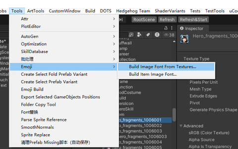
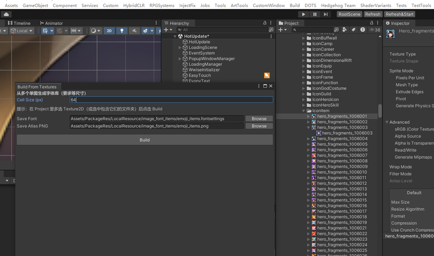
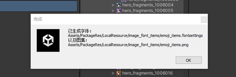
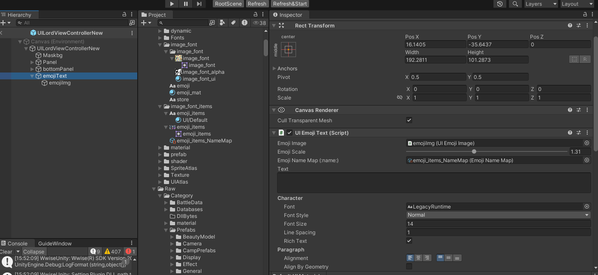
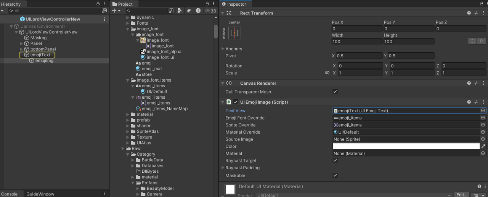
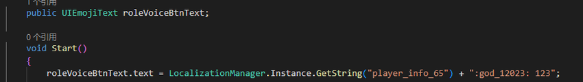
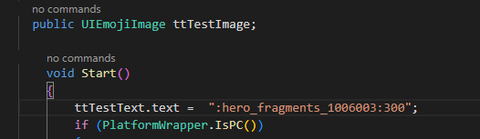

1.制作image_Font​

选中需要的图片或者文件夹点击build​

2.创建emoji文本

​3.使用方式

:hero_fragments_1006003:                      ：图片名字：​

ttTestText.text = LocalizationManager.Instance.GetString("player_info_65") + ":hero_fragments_1006003:300";​

