UI 开发流程​

本文讨论了 UI 开发流程、UI 面板制作、节点命名与绑定以及 UISystem 代码结构等方面的内容。关键要点包括：​

1. UI 开发架构模式：采用 MVVM 模式，View 根据数据刷新界面，通过 ViewModel 获取数据；ViewModel 处理业务逻辑并提供数据接口；Model 定义数据结构和存储数据；Service 负责网络通信。​
1. UI 面板制作：Prefab 路径为 Assets/PackageRes/Raw/Category/Prefabs/UI，各模块自建子目录；面板根节点添加 ComponentLocator 管理 UI 引用，可自动生成绑定代码。​
1. 规范化节点命名：注意 ref vfx 不搜索子节点，嵌套搜索时父节点不用该前缀，tfm 更通用，ref 用于自定义组件。​
1. 自动绑定节点：UI 界面未搭建时，在 BuildIn_keys 预先填写组件名可自动注入生成代码；界面已存在时，修改命名后点自动注入可生成绑定代码。​
1. 代码使用：View 必须继承 IView 接口和 PopupWindow 或 Dialog，预制体挂载 ComponentLocator，通过 Locator._G<T>(index) 获取组件。​
1. UISystem 代码结构：新增界面代码路径为 Assets/Scripts/HOT/UISystems，Model 包括 Data 和 Repository，View 处理 UGUI 相关，ViewModel 封装业务逻辑，Service 负责网络数据请求。​
1. 注意事项：自动生成代码时需确保 Locator 上有继承 IView 的界面脚本，否则编译会报错。 ​

# 架构模式 MVVM​
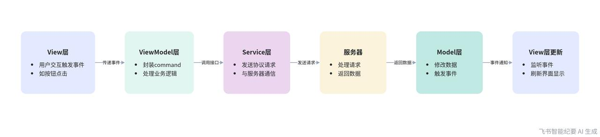
1. View  根据数据刷新显示界面​
   1. 使用 ComponentLocator  收集界面UI组件​
   1. 通过ViewModel获取数据，显示界面​
1. ViewModel  处理界面业务逻辑，提供接口给View 去获取数据 ​
   1. 建议View不要直接访问Model层，应改为ViewModel层提供函数去访问数据返回给view​
   1. 界面简单没有ViewModel层，也可以访问Model​
   1. View层监听ViewModel事件，刷新界面​
      1. 事件触发，尽量在关键功能变化时触发​
      1. 避免仅某一个字段变化就触发事件，进行大量刷新​
      ​
1. Model  定义数据结构，仓库存储全局数据​
   1. 界面需要的数据，集中管理​
   1. 当数据变化时，触发事件，ViewModel层监听并处理​
      1. VM 处理数据后，将事件继续触发，抛给View层​
      ​
1. Service 定义网络通信​
   1. 与服务器交互，发送网络请求，处理服务器网络消息​
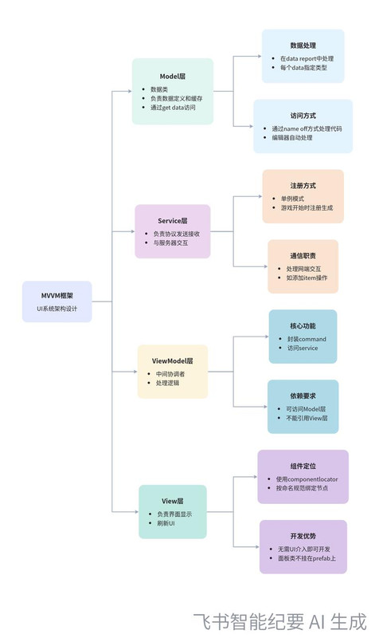

# UI面板制作​

## Prefab路径​

`Assets/PackageRes/Raw/Category/Prefabs/UI​`
各模块自建子目录：skil​
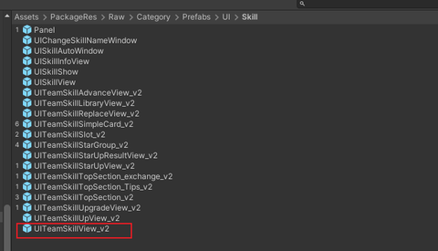

## 添加组件 ComponentLocator  ​

面板根节点需要添加组件收集器，统一由它管理UI的引用，不要在View面板上公开变量，不要直接拖拽​
ComponentLocator  ​
- UI组件收集定位器，统一管理访问预制体Prefab上的UI组件​
- 可以自动生成绑定代码（目前是枚举，后续可扩展更多预先代码）​
- 自动搜索合规命名节点，一键自动注入，持有引用，运行时按索引访问​
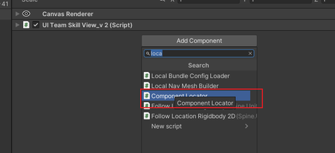
默认无数据​

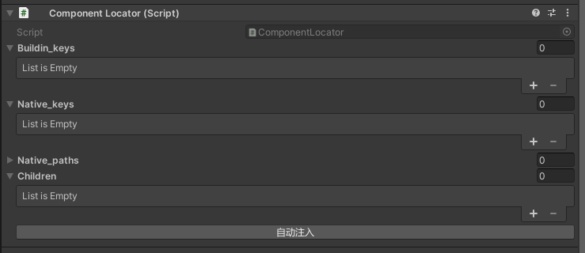

## 规范化节点命名​

注意 ref vfx 目前是不会搜索子节点，如果嵌套搜索，父节点不要用ref  vfx 前缀​
使用tfm 更通用些，ref 用于自定义组件（ref通常自己本身也会挂locator）​
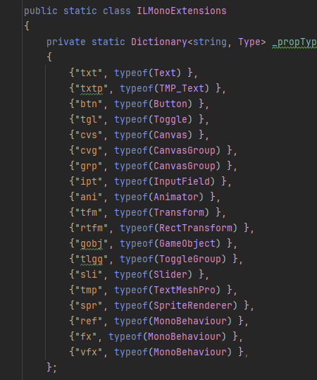
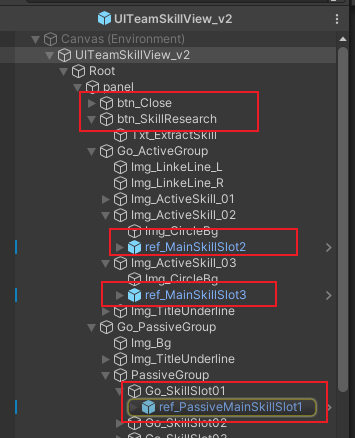

## 自动绑定节点​

### UI界面未搭建（程序比美术先做）​

在BuildIn_keys 预先填写需要的组件名，再点自动注入，也会生成预先填写的组件名枚举​
- 会提醒你，目前面板还没有这些节点​
- 点确定后，会自动生成代码​
注意：这里默认是认为Locator上有一个继承了 IView 的界面脚本的，这个界面名（也是类名）就是节点名​
去掉_ 前缀的后留下的名字​
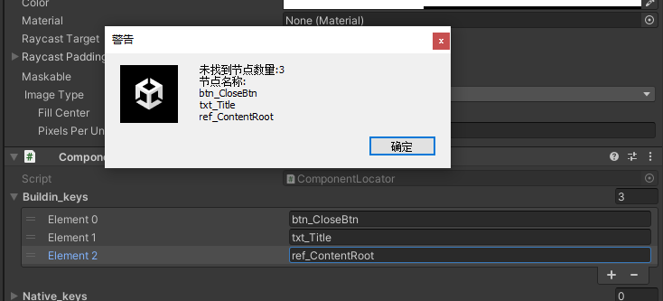
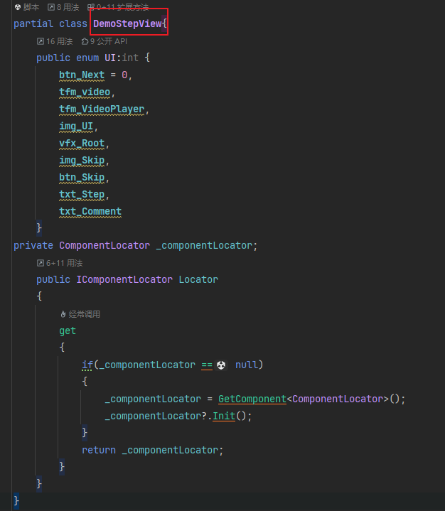
如果仅有Locator，没有挂对应命名的View脚本，自动生成代码后，编译会报错，类似如下​
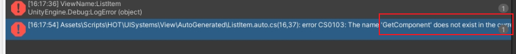

### UI界面已存在（美术已经拼完）​

程序后置，界面已拼接完成​
- 修改命名后，点自动注入​
- 绑定的枚举值会自动生成代码，写入到固定路径下​
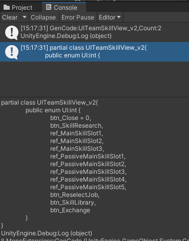
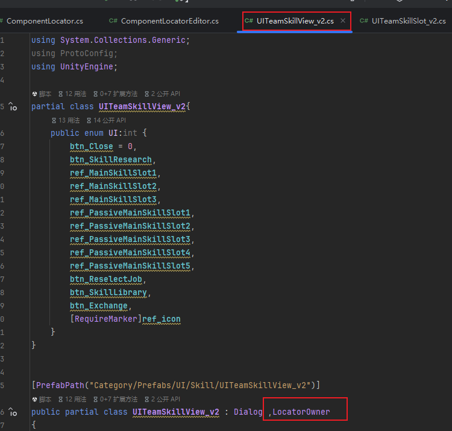
## 代码使用​

View 必须继承 IView  接口（它背后已经继承了 ILocatorOwner）​
目前有一个文档 ​UI 开发流程​
​UI 开发流程​

并继承  PopupWindow 或者 Dialog​
预制体挂载了脚本 ComponentLocator ​
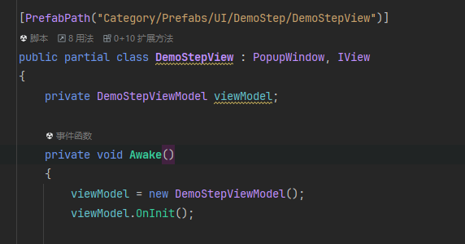
#### 获取任意类型组件​

`Locator._G<UITeamSkillSlotView_v2>((int)UI.ref_MainSkillSlot1)​`
- 使用 Locator._G <T> （index）​
- T 是组件类型​
- index 是自动生成的枚举类型​

#### 常用修改组件值​

Component_EXT2.cs  与 Component_EXT.cs  自行扩展常用接口​
继承了​

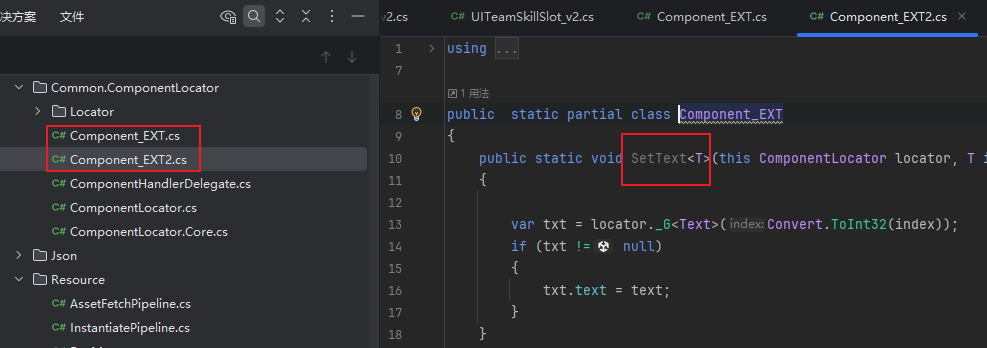
- 设置显示隐藏​
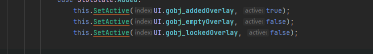

- 设置文本内容​
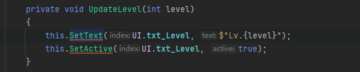

# UISystem 代码结构​

新增界面代码路径​
`Assets/Scripts/HOT/UISystems​`

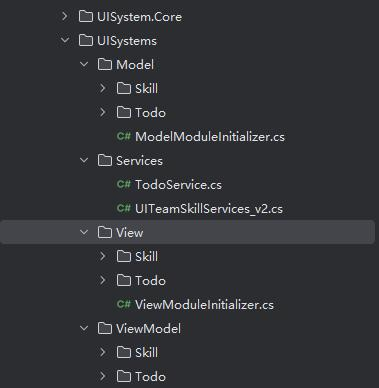

## Model 代码​
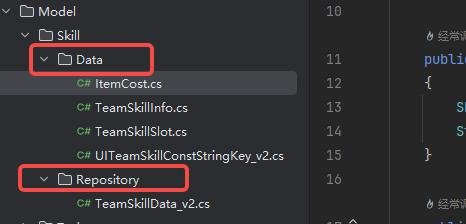
- Data  是自定义类型的数据封装​
- Repository 是全局数据缓存管理​

### 继承 BaseData​

全局数据管理类需要​

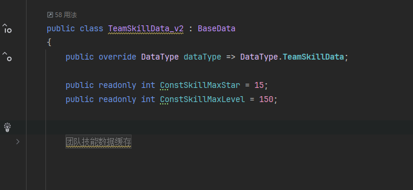

### 访问数据 DataRepository ​

通过GetData<T> 泛型方法访问数据​
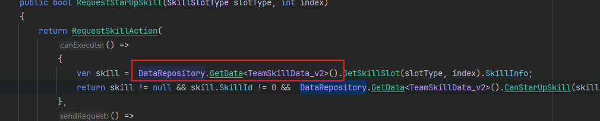
## View 代码​

是界面UGUI相关的处理，参考 UITeamSkillView_v2​
- 继承  Dialog 或 PopupWindow ​
- 继承 IView​
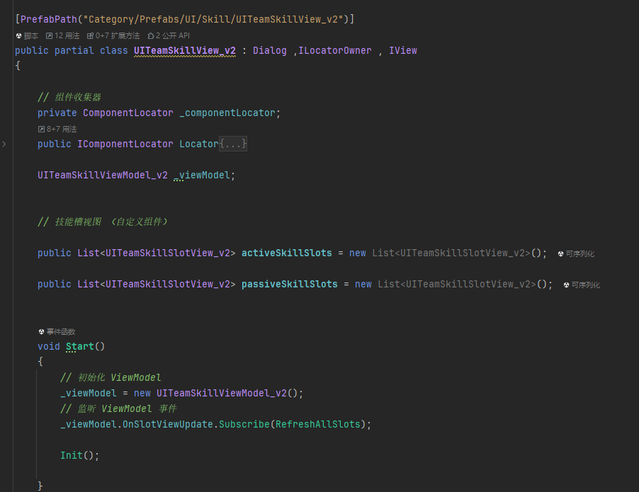

## ViewModel 代码​

是界面的业务逻辑代码，参考 UITeamSkillViewModel_v2​
它主要将界面的业务逻辑，全部封装在一个ViewModel对象中，​
- 继承 IViewModel 接口​
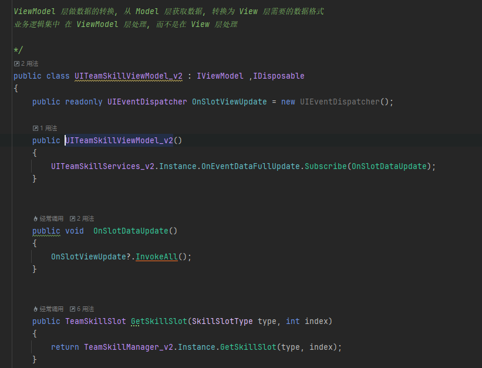

- 将业务逻辑集中在这个处理​

## Service 代码​

### 单例 继承IService​
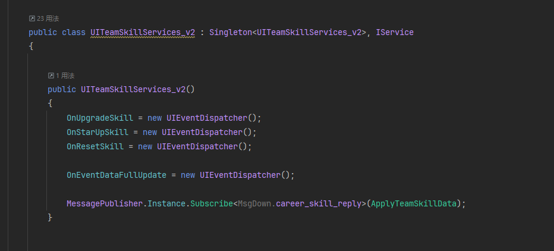

### 请求网络数据​

主要用于与服务器的交互，请求网络数据，在数据修改时，触发事件​
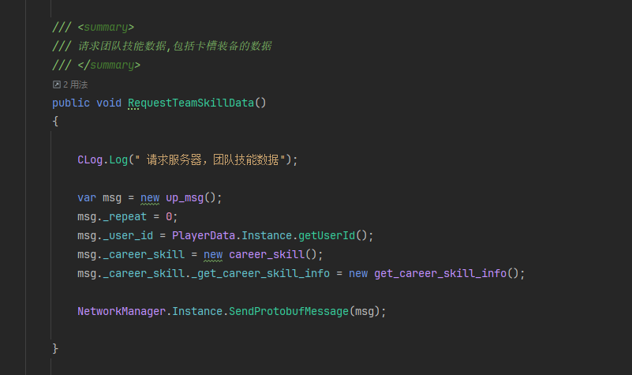
