*当前游戏版本采用的Spine版本为4.0.43，Unity运行库如下：​
​spine-unity-4.0-2021-09-17.unitypackage6.54MB​​
*对Spine版本的更新或运行库的更新，都会导致项目内所有的Spine动画重导，甚至重做（部分文件无法在新版本导出）​
*本文参考的官方文档：http://zh.esotericsoftware.com/spine-unity#%E5%9C%A8Unity%E4%B8%AD%E7%BC%96%E7%A0%81​
​

## 一.导出注意​
因为项目采用线性光照，所以导出时，勾选需要进行下列勾选
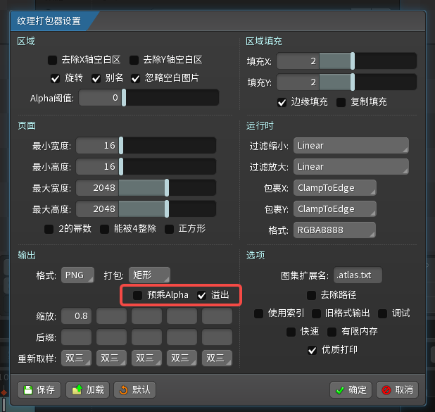

## 二.导入引擎​
导出文件为以下三个：
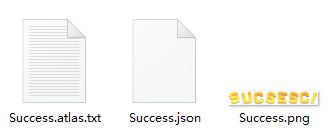
统一存放至工程文件价：\Assets\Resources\Spine

*Spine资源新建一个文件夹，放里面，避免骨骼重复，页方便替换
*制作的Perfab文件就放外面，方便管理
导入后，会自动生成材质等文件（拖入引擎，不要直接复制进文件夹）

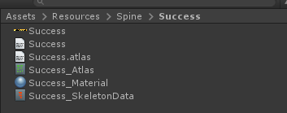

*此时，需要进行以下设置才能正常
图片文件：

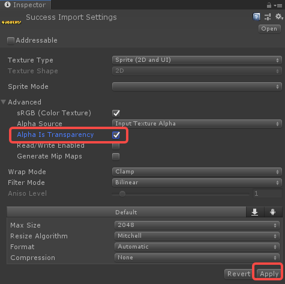

材质文件：
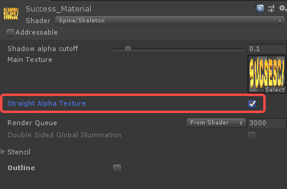
勾选后导入即完成​

## 三.制作Perfab​
制作Perfab有两种方式
1.直接用Spine文件制作Perfab
2.用一个GameObject嵌套
用1有利于代码控制缩放，用2利于融合效果（多Spine和其他功能），自行把控
以下图工程为例，将选中文件拖入Hierarchy中（就拿一个就行）
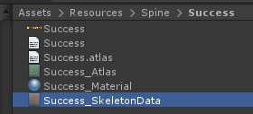
拖入后，选择第一条：
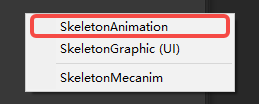


然后对生成的文件进行设置​

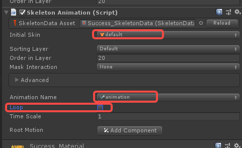

并修改文件名，拖回Create内的Spine文件夹内，制作完成


其他需求下可提交给程序添加功能

## 四.用FGUI播放Spine动画的Perfab​

1.现在对应的FGUI界面内添加一个装载器：PropEffect​
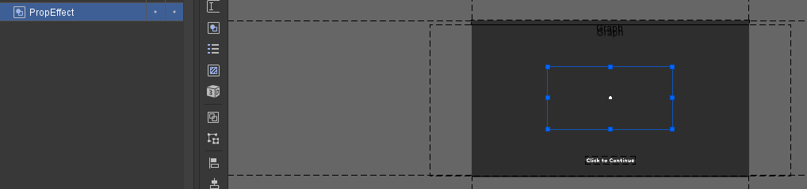
将其定位于希望播放的位置（适配设置好）​
保存-发布​
2.搜索需要添加这个动画的代码文件（和FGUI同名），如：​

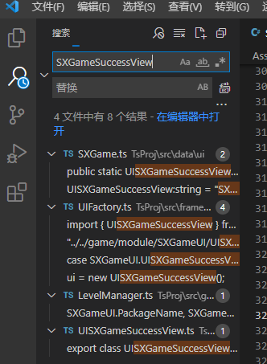

选择这个：

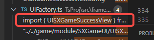

按住Ctrl，点击这个界面：

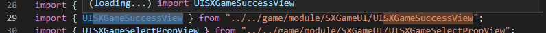

声明下需要添加的FGUI配置名：
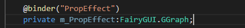
然后在特定代码位置写入代码（一般为onShow）
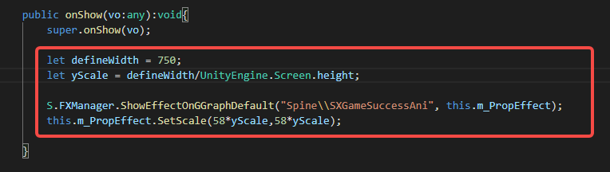

```bash
let defineWidth = 750;
let yScale = defineWidth/UnityEngine.Screen.height;
```

yScale 是基于当前分辨率的“高”，除以标准的750，得到的比值来做缩放​

```kotlin
S.FXManager.ShowEffectOnGGraphDefault("Spine\\SXGameSuccessAni", 
this.m_PropEffect);​
```

表示把Spine\\SXGameSuccessAni这个文件，播放于PropEffect​

```apache
this.m_PropEffect.SetScale(100*yScale,100*yScale);​​
```

表示这个PropEffect需要进行如何缩放，即xy都用 100 乘 适配比​
100是因为代码里的特效都需要放大100倍，基于100倍大小另作大小调整​

## 五.目前项目Spine文件​
### 5.1 三消结算成功提示​
Spine源文件：​
Spine导入文件：\Assets\Resources\Spine\Success​
Spine工程文件：SXGameSuccessAni​
FGUI文件：SXGameSuccessView​
FGUI节点：PropEffect​
### 5.2 启动动画&主页动画&Loading动画​
Spine源文件：​
启动动画：SXG.spine​
Spine导入文件：\Assets\Resources\Spine\LoadingAnim​
Spine工程文件：SXGameMainMove​
动画：SXGamekaichang​


主页动画前景：SXGameAnimationDemo.spine​
Spine导入文件：\Assets\Resources\Spine\LoadingAnim2​
Spine工程文件：LogoAnim_Run2​


Loading动画：SXG.spine​
Spine导入文件：\Assets\Resources\Spine\LoadingAnim​
Spine工程文件：SXGameMainMove​
动画：​
Loading_aiji​
Loading_bosi​
Loading_heben​


成功动画Spine (2).zip124.38KB​​
​片头动画.zip15.23MB​​
Loading_mulan​


主页动画背景：​
​logobg.zip6.48MB​​
Spine导入文件：\Assets\Resources\Spine\Logobg​
Spine工程文件：logobg​

### 5.3 三消结算奖励​
上层：SXGameRewardUp​
中层：照片（于FGUI中）​
下层：SXGameRewardDown​
### 5.4 装扮界面功能Spine​
结算界面.zip3.75MB​​
​场景动画.zip24.47MB​​
工程内仍为导出的帧动画，尚未改为Spine动画​
文件地址：\Assets\Resources\Effect\DressUp​
（可通过用Spine文件替换Perfab的方式直接替换，程序直接用之前的文件做功能）​
### 5.5 三消提示Tips动画​
目前游戏里没有使用​
​Tips.zip446.63KB​​
### 5.6 三消元素Spine​
飞机飞行：​
飞机触发：​
加速道具生成特效Spine：​
​PlaneFly_2.zip518.15KB​​
​飞机触发.zip252.84KB​​
​道具生成.zip173.60KB​​
法杖动画：​
​法杖.zip5.84MB​​
## 六.部分参考文件​
6.1 ​
​Spine女巫动画.rar5.80MB​​
6.2 ​
6.3​
​Spine女巫动画附带PSD.psd7.08MB​​
​Spine发丝飘动.zip2.70MB​​
​cgjoy-钻石练习.zip629.93KB​​

---
