---
title: RG场景地编规范​
category: [代码解析]
date: 2025-12-03
cover_image: images/images_unsplash_com_photo-1555066931-4365d14bab8c.png
excerpt: 本文讨论了 prefab 中特效的处理方式，旨在解决特效嵌入 prefab 导致的资源卸载困难和纹理资源冗余问题，同时统一制作方式并减少程序接入。
tags: [美术, 程序]
---

# unity注意事项​

1.一定要设置为线性空间，不是伽马空间。​
2.​

# 模型篇​

模型制作单位改为米，导出FBX时一定要重置，一定要重置，一定要重置，然后Y轴向上，物体导出坐标归零，重要的事情说三遍！！！！！！​

## 命名规范：​

FBX：SM_​
贴图：T_  (unity中使用的shader通道R代表高光，G代表自发光，所以贴图可以加后缀，T_XXX_R, T_XXX_G)​
材质球：M_​
prafab：举例 ： 白天  ：Bog02_01   夜晚  Bog02_Night_01​
​
地块命名统一使用ground命名，禁止使用其他单词命名。举例：desert_03_ground_01，desert_03_ground_02，desert_03_ground_03​
​
​

## 尺寸规范：​

RG使用的是三个地块循环的方式，所以我们目前只需要做3块地块，每个地块的长30米，宽67米，（长度30米，宽度是左边草坪30米，中间马路7米，右边草坪30米）如下图：​
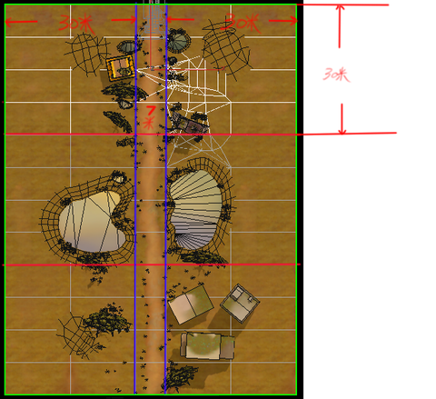
# 贴图合批篇​

## 1.贴图合批​

模型导入unity后，需要贴图合批，合批贴图大小为2048*2048，把所有贴图合并到一张2048*2048贴图中，地表可分为3张单独贴图​
​

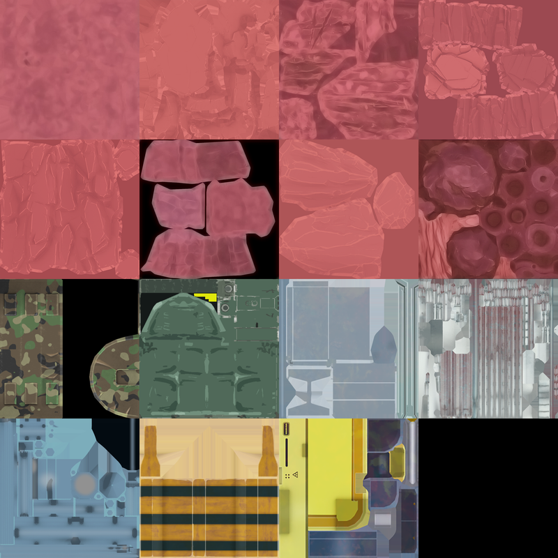

shader中有高光和自发光贴图，这里需要考虑下高光物件要放在同一张贴图中，这样调节一个shader，就基本完成最终效果，不够16张其余空间可留空，像上图一样右下角为空。​

## 2.合批3dmax工具​

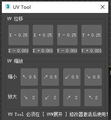

这是3Dmax UV合批工具，使用方法，直接把小工具拖入3dmax里面就可以了。非常简单。​

# 导入unity篇​

导入unity中，切记，不要跨资源使用，例如，你做的是城市，你用了野外问价夹里的树，为了避免之后容易出错，就算要使用野外的树，也要把野外文件夹里的所有资源包括模型+贴图统一拷贝到城市文件夹中。城市的引用必须走城市文件夹下的资源，不能跨资源，不能跨资源，不能跨资源。​

## 1.导入unity中的文件夹规范：​

上图是文件夹规范，按照上图来创建。​

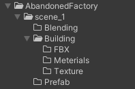

## 2.RG目前是三个地块循环调用，三个地块的prefab坐标为 -30  0  30 ​

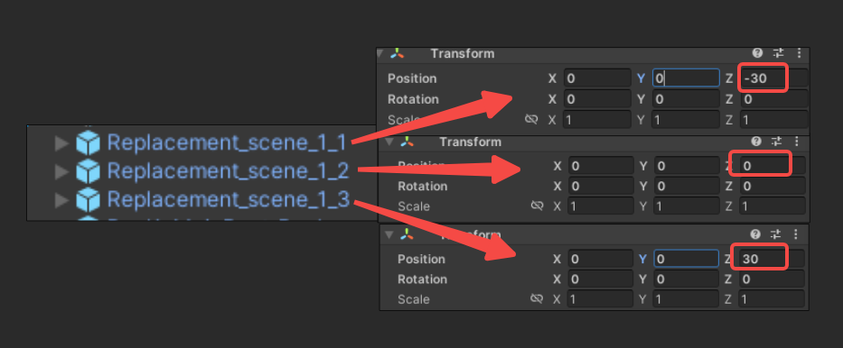

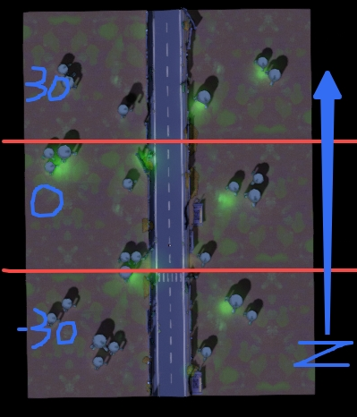
程序调用的就是这三个地块的prefab，保存路径为：Assets/PackageRes/Raw/Category/Prefabs/RunEscapePrefabs/​
天空球prefab路径为：​
Assets/PackageRes/Raw/Category/Prefabs/RunEscapePrefabs/SceneRoots/​
地面Y轴为0的时候会影响上阵，排阵队列特效，所以我们要再做地面的时候Y轴为-0.02与-0.04之间​

## 3.RG摄像机设置：​

### 1) . 跑酷摄像机数值​

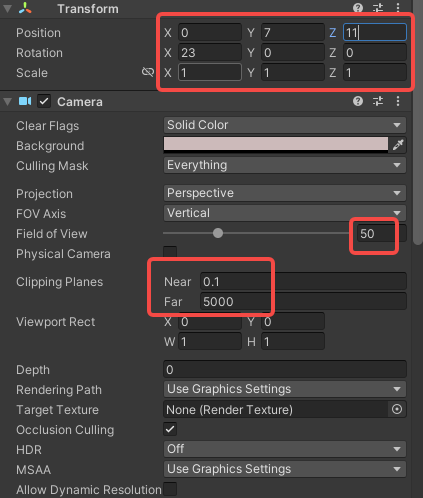
### 2）.战斗摄像机数值​

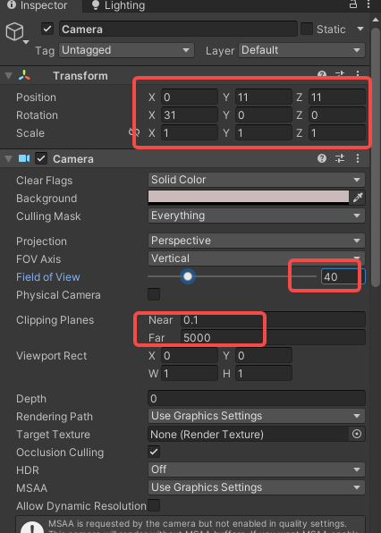

## 4.地块prefab结构​
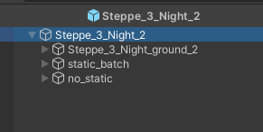

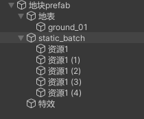
上图为RG项目中所用的prefab结构，下图为解释。​

## 5.地块合批在结构上挂脚本​

1）最上层prefab需要挂脚本，一个是烘焙贴图beke到prefab上的脚本​

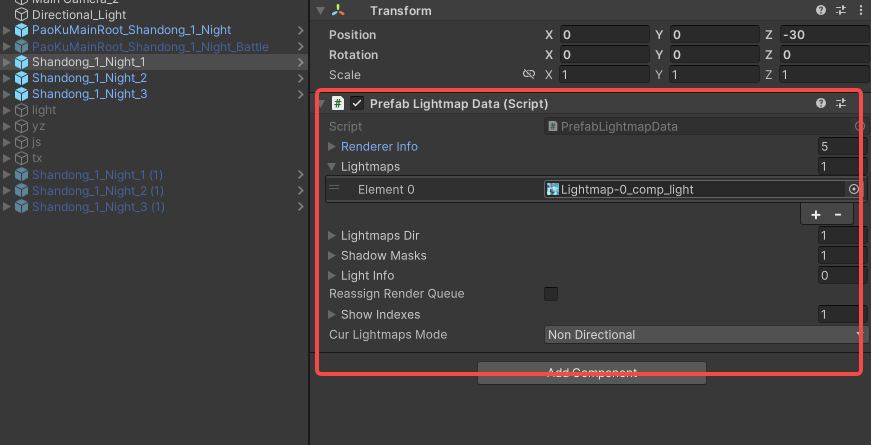

2）lod功能已经弃用。忽略​
3）static_batch这个物体里是存放了所有的资源，所以添加脚本static_batch进行批处理。​

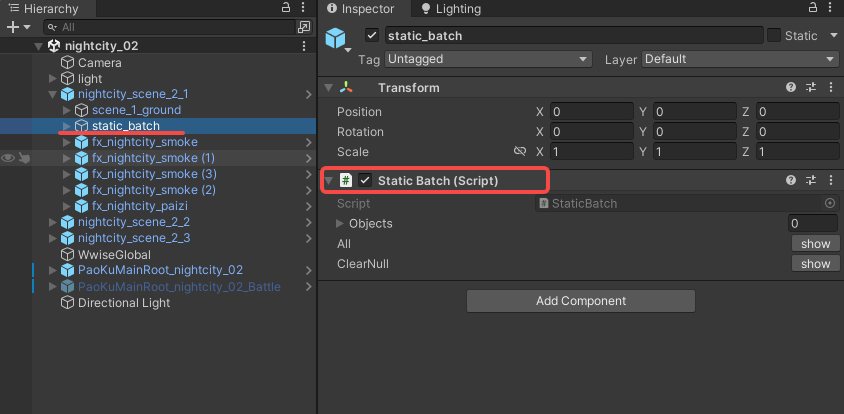

# shader材质篇​

## 1.RG  shader​

RG使用的shader是二次元shader，shader有二分功能，有shader需求联系TA。​

### 描边   ​

OpaqueOutline    ​

### UV移动物体的，skybox​

ElementUnlit_UVMove_Cutout​
ElementUnlit_UVMove_Transparent​
ElementUnlit_UVMove_Transparent_NoFog​

### cutout就是透贴，transparent就是半透​

ElementUnlit_Cutout​
ElementUnlit_Cutout_NoFog​
ElementUnlit_Transparent​

### 采样草​

Vegetation_Lightmap_RS​

### 水面反射​

Water_EasyReflect​
使用最多的为描边shader OpaqueOutline 如下图：​
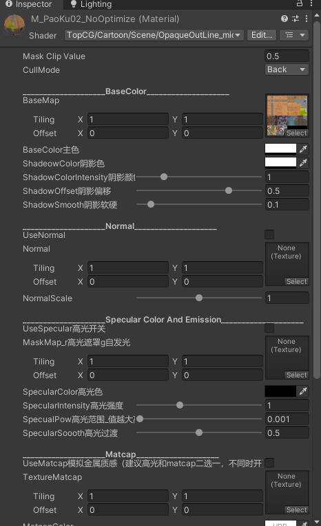
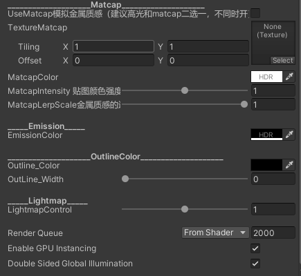

### 烘焙草的方法​

材质需要给赋予urp/baked lit，烘焙完成后在替换我们自己的shader（Opaque）​
烘焙前shader​

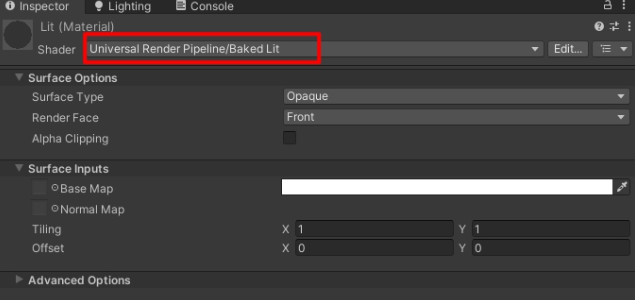

烘焙后shader​

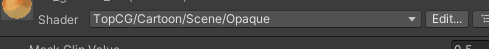

# 实时光篇​

场景仅需要​
- 1盏 实时光（Light）​

- 1盏 角色光 （CharacterLight）​

  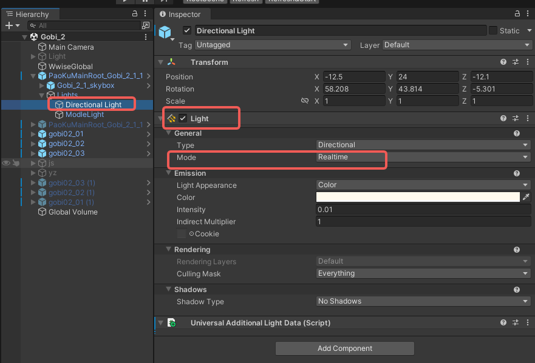

  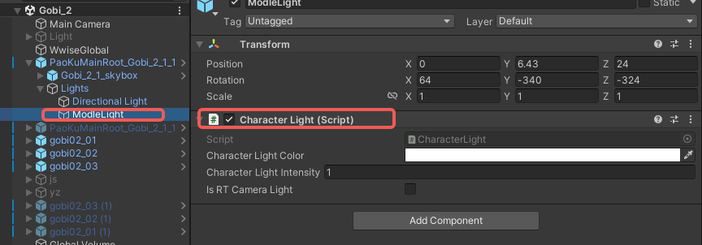

# 灯光烘焙篇​

## 1.烘焙前所需要做的事情​

1）烘焙贴图一个场景最大只用一张2048*2048的贴图。​
2）prefab内除特效外都要勾选静态。​
3）Lightmapping中的Scale In Lightmap 只需设置主mesh，_mid的Lodmesh程序做过处理，是主mesh的一半​

（举例：ground_1 为主mesh ，ground_1_mid为Lodmesh）​
4）烘焙完成后需要bake下灯光贴图，好让贴图贴在prefab脚本上。选中菜单栏Assets/Bake prefab Lightmaps ，bake完成后需要测试是否成功，复制三个地块，然后看看是否变黑，如果变黑bake出错，如果没有任何变化bake成功。​
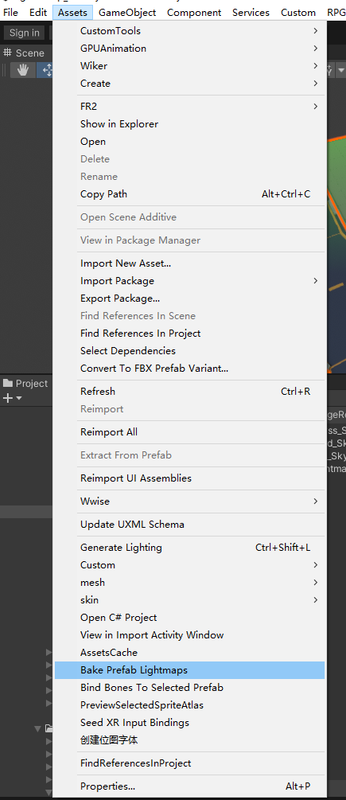
5）bake完成，复制出新的三个prefab，要拼接在一起看一下是否有接缝。每个地块Position的z轴为 60   90  120   ，然后查看地块与地块之间的接缝是否明显，如果有接缝可手动绘制灯光贴图解决接缝问题。​

# 后期效果文件篇​

摄像机上挂在的后效文件都是固定的。都已经调整好了，无需再调整，调整过大，会影响所有场景内角色释放特效的颜色色相。​
只需要挂在默认后期效果文件即可。如下图：​
默认后期效果命名为：CameraProfileType_GJ  下面是默认数值，参数基本是不可动的，动了会影响特效。​

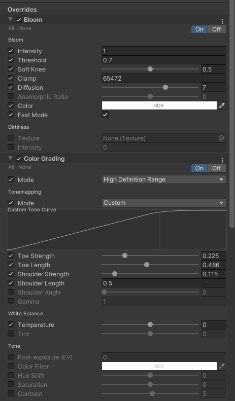

后续继续增加制作流程。。。。。​

