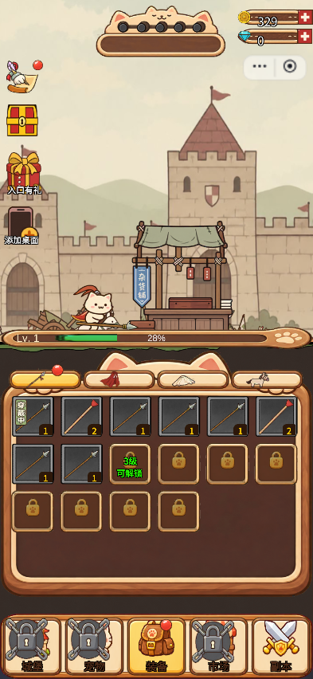

猫骑士的 UI 层没有 Window 基类、没有 UI 栈、没有路由表：`pages/dialogs` 两层宿主挂 66 个 Page，互斥靠字段判空，正确性靠 81 个 UiChecks 兜底。

## 一、只有两层宿主

整个 UI 的骨架是 `Core/Sys/RootUiController.cs` 里的两个 RectTransform：`pages`（全屏页）和 `dialogs`（弹窗）。开机装配只有一段直线代码：

```csharp
private void EnterBattle()
{
    if (MainPage != null) return;
    if (Prologue != null) { Prologue.finished.RemoveListener(EnterBattle); Prologue = null; }
    MainPage = Instantiate(PackageLoader.Current.Asset<GameObject>("ui/main/scenes/GameScene.scene"), pages, false);
    MainPage.GetComponent<CatKnight.Frames.Game.MainPage>().dialogs = dialogs;
    // MainPage.Start binds after this host is supplied; no runtime layout changes.
}
```

`MainPage`（`Frames/Game/MainPage.cs`，1030 行）是唯一的调度中枢：每个弹窗对应一个可空字段（`ShopPage`、`Activity`、`VipPage`、`DailyGift`……），页面类全部是 `sealed MonoBehaviour`，约定三件套——`Open(...)`、`Cancel()/Close()`、完成回调。Frames 目录下 140 个 .cs 里，`*Page` 后缀 66 个。没有基类意味着没有统一的生命周期钩子可依赖，契约全靠约定和检查，这是这个方案的底色。

游戏里的主城画面就是这个 pages 宿主下的一个全屏 Page（GameScene）——资源栏、装备坞背包、底部 tab 全部在它自己的层级里排版，弹窗则统一实例化到 dialogs 宿主：



## 二、"暂停态"是字段聚合，不是栈查询

常见框架回答"现在是否暂停"会去查 UI 栈是否非空。我们把它写成了字段聚合——`MainPage` 顶部两个属性：

```csharp
private bool HasDockModal => automaticMerge?.Offer != null || campaignHud?.DebugPage != null || bag.HasModal || Mansion?.Treasure != null || Mansion?.Help != null ||
    PetBag?.Details != null || PetBag?.Acquisition != null || PetBag?.EggPanel?.Busy == true || PetBag?.CollectionPanel?.Busy == true;
public bool IsCombatPaused => applicationPaused || applicationUnfocused || HasDockModal || SideDungeonMenu != null || TowerPage != null || RaidPage != null ||
    ShopPage != null || Activity != null || VipPage != null || VipLevelUp != null || TasksPage != null || IncomePage != null ||
    HomeUtility != null || Leaderboard != null || DailyGift != null || TreasureHelp != null || RewardSummary != null || LanternPage != null;
```

原因很直接："哪些弹窗挡住战斗"是玩法事实，不是数据结构事实。栈查询只能告诉你"有东西开着"，不能区分挂机收益页（要暂停）和 toast（不暂停）。把清单摊开写，每一行都可审、可注释、可检查——代价是每加一种弹窗要手动登记，漏登记编译器不管（见第五节）。

## 三、打开一个弹窗：三步加回滚

典型入口 `OpenShop()`（`MainPage.cs:431`）只有三步，外加一条完整的失败回滚：

```csharp
var page = Instantiate(PackageLoader.Current.Asset<GameObject>("ui/shop/scenes/ShopScene.scene"), dialogs, false).GetComponent<CatKnight.Frames.Shop.ShopPage>();
ShopPage = page; battleInput.Stop(); battleInput.SetBlocked(page, true);
try { page.Open(runtime, () => { if (ShopPage == page) ShopPage = null; battleInput.SetBlocked(page, false); Changed("shop_closed", null); }); }
catch { page.gameObject.SetActive(false); Destroy(page.gameObject); ShopPage = null; battleInput.SetBlocked(page, false); throw; }
```

四个动作各有含义：实例从 catalog 按键取（`ui/shop/scenes/ShopScene.scene` 的命名约定贯穿全工程）；字段赋值在 `Open` 之前完成，互斥守卫立即生效；`battleInput.Stop()/SetBlocked` 把战斗输入显式交接给弹窗；`try/catch` 保证 Open 中途抛异常时实例销毁、字段复位、输入恢复、异常继续上抛。Dock 类面板（庄园/宠物包）的互斥另有 `CloseDockPanels()`：关旧开新，切完回装备坞。

## 四、生命周期契约：Open 一次、Cancel 兜底、动效收尾

没有基类，契约就写在最常用的页面里当范本。`Frames/Common/ConfirmationPage.cs` 是最短的一个：

```csharp
public void Open(string heading, string message, Action<bool> callback, bool requireDecision = false)
{
    if (closed != null || callback == null) throw new InvalidOperationException("Open a confirmation once");
    // ...
}
private void Finish(bool accepted)
{
    if (settled) return; settled = true; PopupMotion.Hide(gameObject); closed?.Invoke(accepted);
}
public void Cancel() => Finish(false);
private void OnDisable() { if (!settled) Cancel(); }
```

三条铁律：`Open` 重复调用直接抛异常（一个页面实例只活一轮）；结算有 `settled` 防重入；`OnDisable` 时未结算自动 `Cancel()`——弹窗被外部销毁不会留下悬空回调。开关动效统一在 `Core/Component/PopupMotion.cs`：0.2 秒 Back ease（`1 + 2.70158f*u³ + 1.70158f*u²`）从 0.1 倍缩放弹出，`Hide()` 反向播完再 `Destroy`，静态 `HashSet<PopupMotion> playing` 供外部查询"有没有弹窗正在动"。

全工程唯一真正的队列是 toast（`TextTipPresenter`）：`List<(string, double)>` 排队 + `HashSet<string>` 去重（同一条提示不重复弹）+ 协程逐条出队。弹窗不排队——排队意味着同时有多个弹窗待开，这本身就是设计问题。

## 五、正确性不靠框架，靠检查

没有基类统一拦截，错误只能靠检查网兜住：`Assets/Editor` 下 **81 个 `*UiChecks.cs`**，全部是编辑器协程。代表性的一段（`ActivityOffersUiChecks.cs`）验证"按钮真的可点，且点了不产生任何存档副作用"：

```csharp
var hits = new List<RaycastResult>(); EventSystem.current.RaycastAll(pointer, hits);
check(button.isActiveAndEnabled && button.IsInteractable() && hits.Count > 0 &&
    ExecuteEvents.GetEventHandler<IPointerClickHandler>(hits[0].gameObject) == button.gameObject, "...");
var before = runtime.Models.Session.CreateCheckpoint(); var disk = File.ReadAllBytes(DesktopAccountRuntime.StoragePath);
ExecuteEvents.Execute(button.gameObject, pointer, ExecuteEvents.pointerClickHandler);
check(JToken.DeepEquals(before, runtime.Models.Session.CreateCheckpoint()) && disk.SequenceEqual(File.ReadAllBytes(DesktopAccountRuntime.StoragePath)), "unavailable SDK or dismiss never grants/consumes/saves");
```

点击不是直接调方法，而是构造 `PointerEventData` 走 `RaycastAll` 命中测试——遮罩挡没挡住、按钮被谁盖住，这类框架层问题在这里现形；存档 checkpoint 和磁盘字节双重比对，把"点了不该点的按钮"也纳入断言。

代价照实说：互斥守卫和暂停聚合靠手写，漏登记没有编译错误，只能靠 UiChecks 事后暴露；`MainPage` 1030 行，字段改名牵一发动全身。换来的是零框架魔法——每个弹窗的行为都能在一处代码里读完。

上线前核对：

- 新弹窗先补 `MainPage` 字段 + `OpenXxx` 互斥守卫 + `IsCombatPaused` 登记，三处缺一不可
- 页面类保持 `sealed`，遵守 Open 一次 / Cancel 兜底 / `settled` 防重入
- 弹窗打开必须走 `try { Open } catch { 销毁+复位+上抛 }`，输入交接（Stop/SetBlocked）成对出现
- 交互改动跑对应 `*UiChecks`（编辑器协程），弹窗动效期间的状态查询用 `PopupMotion.AnyPlaying`
- `rg "sortingOrder"` 只允许 PetEggView 拖拽一处；层级调整走父子关系
